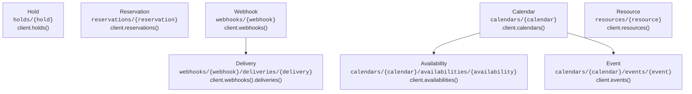
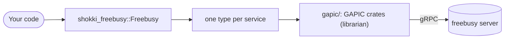

<!-- Code generated by protoc-gen-sdk 0.2.4. DO NOT EDIT. -->
# freebusy Rust SDK

[](https://crates.io/crates/shokki-freebusy)
[](https://docs.rs/shokki-freebusy)
[](https://github.com/oh-tarnished/freebusy-rs-sdk/actions/workflows/ci.yaml)

Availability, holds, reservations and webhooks for anything that can be booked.

freebusy answers what is free, holds it while a customer decides, and
turns holds into reservations, for any bookable resource: rooms, bays,
desks, people.

The freebusy Rust SDK is one client for every service of the freebusy API,
over gRPC, async on Tokio. Requests and responses are the API's own
messages, re-exported from `shokki_freebusy`; errors carry the gRPC status code and
the API's error reasons; list methods page automatically; timeouts and
retries can be set for the client or one service.

## Contents

- [Installation](#installation)
- [Quick start](#quick-start)
- [Configuration](#configuration)
- [Services](#services)
- [Types](#types)
- [Pagination](#pagination)
- [Errors](#errors)
- [Retries and timeouts](#retries-and-timeouts)
- [How it fits together](#how-it-fits-together)
- [Examples](#examples)
- [Versioning](#versioning)

## Installation

```sh
cargo add shokki-freebusy
cargo add tokio --features macros,rt-multi-thread
```

It needs Rust 1.91 or later.

## Quick start

```rust
use shokki_freebusy::{
    ComputeAvailabilityRequest, Freebusy, SearchAvailabilityRequest, google_cloud_type,
};

#[tokio::main]
async fn main() -> shokki_freebusy::Result<()> {
    let client = Freebusy::new().await?;
    let request =
        SearchAvailabilityRequest::new().set_window(google_cloud_type::model::Interval::default());
    let mut items = client
        .availability()
        .search_availability_auto_paging(request);
    while let Some(item) = items.next().await {
        println!("{:?}", item?);
    }
    let request =
        ComputeAvailabilityRequest::new().set_window(google_cloud_type::model::Interval::default());
    let result = client.availability().compute_availability(request).await?;
    println!("{result:?}");
    Ok(())
}
```

`Freebusy::new()` connects to `freebusy.shokki.engineering:443` over TLS. Every method takes
the request message and returns the response message.

## Configuration

The builder's settings, then the environment, then the defaults:

| Builder | Variable | Default | |
|---|---|---|---|
| `with_endpoint` | `FREEBUSY_ENDPOINT` | `freebusy.shokki.engineering:443` | The server, `host:port` or a URL. |
| `with_insecure` | `FREEBUSY_INSECURE` | `false` | Connect without TLS, for a local server. |
| `with_timeout` | | none | A bound on each attempt of a call. |
| `with_max_retries` | | `2` | Retries of `UNAVAILABLE`, with exponential backoff. |
| `with_header` | | | gRPC metadata sent with every call. |

```rust
use std::time::Duration;

use shokki_freebusy::Freebusy;

async fn connect() -> shokki_freebusy::Result<Freebusy> {
    Freebusy::builder()
        .with_endpoint("localhost:50051")
        .with_insecure(true)
        .with_header("x-request-source", "batch")
        .with_timeout(Duration::from_secs(10))
        .with_max_retries(3)
        .build()
        .await
}
```

One service with options of its own (cloning shares the connection):

```rust
use std::time::Duration;

fn options(client: &shokki_freebusy::Freebusy) -> shokki_freebusy::AvailabilityService {
    client
        .availability()
        .with_timeout(Duration::from_secs(2))
        .with_max_retries(0)
}
```

## Services

| Accessor | Service | |
|---|---|---|
| `client.availability()` | `freebusy.allocation.v1.AllocationService` | AllocationService is the read-only half of the engine: it answers how much is free, and never changes anything. |
| `client.holds()` | `freebusy.allocation.v1.HoldService` | HoldService takes and releases expiring claims on resources. |
| `client.reservations()` | `freebusy.reservation.v1.ReservationService` | ReservationService turns holds into confirmed bookings, updates and cancels them. |
| `client.webhooks()` | `freebusy.webhook.v1.WebhookService` | WebhookService subscribes endpoints to changes in holds, reservations and inventory, and shows what was sent to each. |
| `client.webhooks().deliveries()` | `freebusy.webhook.v1.WebhookService` |  |
| `client.resources()` | `protobuf.rfc9073.resource.v1.Resources` | Resources manages the RFC 9073 VRESOURCE component as a catalogue, section 7.3 <https://www.rfc-editor.org/rfc/rfc9073.html#section-7.3>. |
| `client.calendars()` | `protobuf.rfc5545.calendar.v1.Calendars` | Calendars manages the collections that Events belong to, RFC 5545 section 3.4 <https://www.rfc-editor.org/rfc/rfc5545.html#section-3.4>. |
| `client.events()` | `protobuf.rfc5545.event.v1.Events` | Events manages RFC 5545 events as resources. |
| `client.availabilities()` | `protobuf.rfc7953.availability.v1.Availabilities` | Availabilities manages when a calendar's owner may be scheduled. |

Every method, with its request and result: [`client.availability()`](docs/availability.md), [`client.holds()`](docs/holds.md), [`client.reservations()`](docs/reservations.md), [`client.webhooks()`](docs/webhooks.md), [`client.resources()`](docs/resources.md), [`client.calendars()`](docs/calendars.md), [`client.events()`](docs/events.md), [`client.availabilities()`](docs/availabilities.md).

The API's methods, in AIP terms:

| AIP | Rust |
|---|---|
| `CreateX` | `create` |
| `GetX`, `UpdateX`, `DeleteX` | `get`, `update`, `delete` |
| `ListXs` | `list` (one page) and `list_auto_paging` (every item, a `Pager`) |
| custom `:verb` | the verb, snake_case: `:lend` is `lend` |
| child resource | a nested service: `client.shelves().books()` |
| `REQUIRED` fields | checked before the call: `Code::InvalidArgument` naming the field |
| `google.protobuf.Empty` result | `()` |

The API's resources, and the service that manages each:



## Types

Every message and enum of the API is a type of crate `shokki_freebusy`: the GAPIC
crates' own, re-exported under their SDK names, not copies of them. Build
messages with `new()` and the `set_*` methods, read their public fields,
compare them with `==`, and serialize them with serde; the types nested in a
message are in the module of its name in snake_case. The protobuf
well-known types are `shokki_freebusy::wkt`.

```rust
use shokki_freebusy::{ComputeAvailabilityRequest, google_cloud_type};

fn request() -> ComputeAvailabilityRequest {
    ComputeAvailabilityRequest::new().set_window(google_cloud_type::model::Interval::default())
}
```

## Pagination

`client.availability().search_availability` returns one page. `search_availability_auto_paging` returns a
`Pager` of every item of every page, fetching the next page when one runs
out; it is also a `futures::Stream`.

```rust
use shokki_freebusy::{Freebusy, SearchAvailabilityRequest, google_cloud_type};

async fn every_item(client: &Freebusy) -> shokki_freebusy::Result<()> {
    let request =
        SearchAvailabilityRequest::new().set_window(google_cloud_type::model::Interval::default());
    let mut items = client
        .availability()
        .search_availability_auto_paging(request);
    while let Some(item) = items.next().await {
        println!("{:?}", item?);
    }
    Ok(())
}
```

## Errors

Every method returns `shokki_freebusy::Result`; an `Error` carries the gRPC status
code, its message, and the `google.rpc.ErrorInfo` reason and domain the
server attached:

```rust
use shokki_freebusy::{Code, ComputeAvailabilityRequest, ErrorReason, Freebusy, google_cloud_type};

async fn handle(client: &Freebusy) -> shokki_freebusy::Result<()> {
    let request =
        ComputeAvailabilityRequest::new().set_window(google_cloud_type::model::Interval::default());
    match client.availability().compute_availability(request).await {
        Ok(result) => println!("{result:?}"),
        Err(err) if err.code() == Code::NotFound => println!("nothing there"),
        Err(err) if err.is_reason(ErrorReason::InvalidTimeZone) => println!("{err}"),
        Err(err) => return Err(err),
    }
    Ok(())
}
```

The API's reasons, as `ErrorReason` variants:

| Variant | Reason | Status | |
|---|---|---|---|
| `ErrorReason::InvalidTimeZone` | `INVALID_TIME_ZONE` | `InvalidArgument` | `time_zone` is not an IANA zone name. Use one such as `Europe/London`, or leave it empty for the zone of the first resource's calendar. |
| `ErrorReason::TooManyBuckets` | `TOO_MANY_BUCKETS` | `InvalidArgument` | The window would be answered in too many buckets. A shorter window, a longer `slot_duration`, or day granularity. |
| `ErrorReason::InvalidFilter` | `INVALID_FILTER` | `InvalidArgument` | `filter` (or `hold.candidate_filter` on `CreateHold`) is not an AIP-160 filter over a resource's search record: a syntax error, or a field it does not have. Filter on `resource_types`, `display_name` and `attributes.<path>`, e.g. |
| `ErrorReason::FilterUnsupported` | `FILTER_UNSUPPORTED` | `InvalidArgument` | The filter is valid, but the backend the search records are read on cannot evaluate it: on a Hasura-only deployment (no `[database.postgres]`), a `:` on `resource_types`, since DDN over ndc-postgres has no comparison on array columns. Pass the types in the request's `resource_types` field instead, or configure Postgres for the server. |
| `ErrorReason::InvalidOrderBy` | `INVALID_ORDER_BY` | `InvalidArgument` | `SearchAvailability`'s `order_by` names a field matches cannot be ordered by, or a direction other than `asc`/`desc`. Order by `resource`, `display_name`, `free_fraction` or `attributes.max_occupancy`. |
| `ErrorReason::OrderByUnsupported` | `ORDER_BY_UNSUPPORTED` | `InvalidArgument` | `SearchAvailability`'s `order_by` is valid, but orders by an attribute path (`attributes.max_occupancy`) that the backend the search records are read on cannot sort by: DDN's order_by, on a Hasura-only deployment, has no JSON path expression. Order by `resource`, `display_name` or `free_fraction`, or configure Postgres for the server. |
| `ErrorReason::InvalidFacet` | `INVALID_FACET` | `InvalidArgument` | `SearchAvailability`'s `facets` names a field resources cannot be counted by. Count by `resource_types`, `display_name` or `attributes.<path>`. |
| `ErrorReason::InvalidPageToken` | `INVALID_PAGE_TOKEN` | `InvalidArgument` | `SearchAvailability`'s `page_token` is not one it returned. Send `next_page_token` unchanged, with the same other fields, or leave it empty. |
| `ErrorReason::WindowBeyondHorizon` | `WINDOW_BEYOND_HORIZON` | `InvalidArgument` | `SearchAvailability` with `order_by` or `facets` for a window outside the search records' horizon (yesterday to `[search] horizon_days` ahead). Search inside the horizon, or leave `order_by` and `facets` empty. |
| `ErrorReason::EngineBusy` | `ENGINE_BUSY` | `ResourceExhausted` | `SearchAvailability`, `ComputeAvailability`, `BatchComputeAvailability`, `CheckAvailability` or `CreateHold`: as many availability evaluations as the server runs at once (`[engine] max_evaluations`) were running, and none finished within `[engine] admission_wait_ms`. Retry after a short randomized backoff; a narrower request (a resource type, a tighter filter, a smaller page) is cheaper. |
| `ErrorReason::CapacityExhausted` | `CAPACITY_EXHAUSTED` | `FailedPrecondition` | `CreateHold`: fewer resources are free for the whole window than were asked for. Ask for fewer, or another window; `ComputeAvailability` shows what is free. |
| `ErrorReason::OutsideAvailability` | `OUTSIDE_AVAILABILITY` | `FailedPrecondition` | `CreateHold`: the window is outside the published availability of every resource asked about (closed then), so nothing is offered at all. Ask for a window inside opening hours; `ComputeAvailability` shows what is offered and free. |
| `ErrorReason::InvalidHoldExtension` | `INVALID_HOLD_EXTENSION` | `InvalidArgument` | `ExtendHold`'s `duration` is zero, negative or above the maximum. Extend by less, again before it expires if needed. |
| `ErrorReason::HoldNotActive` | `HOLD_NOT_ACTIVE` | `FailedPrecondition` | The hold expired, was released, or became a reservation. Take a new hold. |
| `ErrorReason::HoldConverted` | `HOLD_CONVERTED` | `FailedPrecondition` | `ReleaseHold` on a hold that became a reservation. Cancel the reservation instead. |
| `ErrorReason::HoldActive` | `HOLD_ACTIVE` | `FailedPrecondition` | `DeleteHold` on a hold that still holds its resources. `ReleaseHold` first. |
| `ErrorReason::ReplacedHoldNotBooked` | `REPLACED_HOLD_NOT_BOOKED` | `FailedPrecondition` | `CreateHold`: `hold.replaces` names a hold that backs no booking still keeping its resources -- it never became a reservation, or that reservation was cancelled or moved. Send the `hold` of a confirmed reservation, or leave `replaces` empty. |
| `ErrorReason::HoldIdTaken` | `HOLD_ID_TAKEN` | `AlreadyExists` | `CreateHold`: `hold_id` names a hold that already exists. Choose another id, or leave it empty; send `request_id` to make a retry safe. |
| `ErrorReason::HoldNotFound` | `HOLD_NOT_FOUND` | `InvalidArgument` | The reservation's `hold` does not exist, or `CreateHold`'s `hold.replaces` names one that does not. Take a hold first with `CreateHold`; for `replaces`, send the reservation's `hold`. |
| `ErrorReason::HoldLapsed` | `HOLD_LAPSED` | `FailedPrecondition` | The hold lapsed before the reservation was confirmed; the reservation failed. Take a new hold and create the reservation again; hold longer, or `ExtendHold`. |
| `ErrorReason::ReservationIdTaken` | `RESERVATION_ID_TAKEN` | `AlreadyExists` | `reservation_id` names a reservation made from another hold. Choose another id, or leave it empty. |
| `ErrorReason::ReservationFailed` | `RESERVATION_FAILED` | `FailedPrecondition` | `CancelReservation` on a reservation that failed; it holds nothing. Nothing to do. |
| `ErrorReason::ReservationMoved` | `RESERVATION_MOVED` | `FailedPrecondition` | The reservation was rescheduled; its replacement holds the booking. Act on the replacement the message names. |
| `ErrorReason::ReservationNotConfirmed` | `RESERVATION_NOT_CONFIRMED` | `FailedPrecondition` | Only a confirmed reservation can be rescheduled or updated; this one is cancelled, cancelling or failed. Create a new reservation from a new hold. |
| `ErrorReason::RescheduleInProgress` | `RESCHEDULE_IN_PROGRESS` | `FailedPrecondition` | The reservation is being moved, so it cannot be moved elsewhere or updated. Wait for that move; `GetReservation` shows its state. |
| `ErrorReason::SameHold` | `SAME_HOLD` | `InvalidArgument` | Rescheduling onto the hold the reservation was made from changes nothing. Take a hold for the new window and reschedule onto it. |
| `ErrorReason::ReplacementFailed` | `REPLACEMENT_FAILED` | `FailedPrecondition` | The new slot could not be booked; the reservation keeps its original one. Take a fresh hold and reschedule again. |
| `ErrorReason::HoldForReschedule` | `HOLD_FOR_RESCHEDULE` | `FailedPrecondition` | The hold was taken to replace a booking (`hold.replaces`), so it can only be used to reschedule the reservation made from that hold. `RescheduleReservation` that reservation onto it, or take a hold without `replaces`. |
| `ErrorReason::InvalidUri` | `INVALID_URI` | `InvalidArgument` | `uri` is not an absolute URL. Send scheme, host and path. |
| `ErrorReason::UriHasCredentials` | `URI_HAS_CREDENTIALS` | `InvalidArgument` | `uri` carries a username or password. Remove them; verify the delivery signature instead. |
| `ErrorReason::UriNotHttps` | `URI_NOT_HTTPS` | `InvalidArgument` | `uri` is not https. Serve the endpoint over https. |
| `ErrorReason::UriNotPublic` | `URI_NOT_PUBLIC` | `InvalidArgument` | `uri` resolves to a private or loopback address. Expose it publicly. |
| `ErrorReason::UnknownEventType` | `UNKNOWN_EVENT_TYPE` | `InvalidArgument` | An entry in `event_types` is not an event freebusy sends. Choose from the list in the message, or leave it empty for all. |
| `ErrorReason::WebhookHasDeliveries` | `WEBHOOK_HAS_DELIVERIES` | `FailedPrecondition` | The webhook still has deliveries on record. Send `force=true`, or `PauseWebhook` to keep the record. |

## Retries and timeouts

A call failing with `UNAVAILABLE` is retried up to `with_max_retries` times
(default 2), with exponential backoff and jitter.
`with_timeout` bounds each attempt, and fails it with
`Code::DeadlineExceeded` when it runs out. Both can be set for the client,
or for one service (its `with_timeout` and `with_max_retries` return a copy).

## How it fits together



| Path | What | Generated by |
|---|---|---|
| `src/lib.rs` | the crate root: the client, the API's types, errors, `Pager` | protoc-gen-sdk |
| `src/client.rs` | the client and its builder | protoc-gen-sdk |
| `src/availability.rs` | `AvailabilityService` | protoc-gen-sdk |
| `src/holds.rs` | `HoldService` | protoc-gen-sdk |
| `src/reservations.rs` | `ReservationService` | protoc-gen-sdk |
| `src/webhooks.rs` | `WebhookService` and the services under it | protoc-gen-sdk |
| `src/resources.rs` | `ResourceService` | protoc-gen-sdk |
| `src/calendars.rs` | `CalendarService` | protoc-gen-sdk |
| `src/events.rs` | `EventService` | protoc-gen-sdk |
| `src/availabilities.rs` | `AvailabilitiesService` | protoc-gen-sdk |
| `gapic/shokki-freebusy-gapic-freebusy-allocation-v1/` | the GAPIC client and types of `freebusy.allocation.v1` (internal) | librarian |
| `gapic/shokki-freebusy-gapic-freebusy-reservation-v1/` | the GAPIC client and types of `freebusy.reservation.v1` (internal) | librarian |
| `gapic/shokki-freebusy-gapic-freebusy-webhook-v1/` | the GAPIC client and types of `freebusy.webhook.v1` (internal) | librarian |
| `gapic/shokki-freebusy-gapic-protobuf-rfc5545-calendar-v1/` | the GAPIC client and types of `protobuf.rfc5545.calendar.v1` (internal) | librarian |
| `gapic/shokki-freebusy-gapic-protobuf-rfc5545-event-v1/` | the GAPIC client and types of `protobuf.rfc5545.event.v1` (internal) | librarian |
| `gapic/shokki-freebusy-gapic-protobuf-rfc7953-availability-v1/` | the GAPIC client and types of `protobuf.rfc7953.availability.v1` (internal) | librarian |
| `gapic/shokki-freebusy-gapic-protobuf-rfc9073-resource-v1/` | the GAPIC client and types of `protobuf.rfc9073.resource.v1` (internal) | librarian |
| `tests/` | every method against an in-process fake gRPC server | protoc-gen-sdk |

## Examples

Runnable starting points, configured by the environment (`FREEBUSY_ENDPOINT`,
`FREEBUSY_INSECURE`):

```sh
cargo run --example booking
```

## Versioning

Releases follow semantic versioning; the version is the git tag. The API's
own changes arrive through the regenerate workflow; see
[CHANGELOG.md](CHANGELOG.md).
